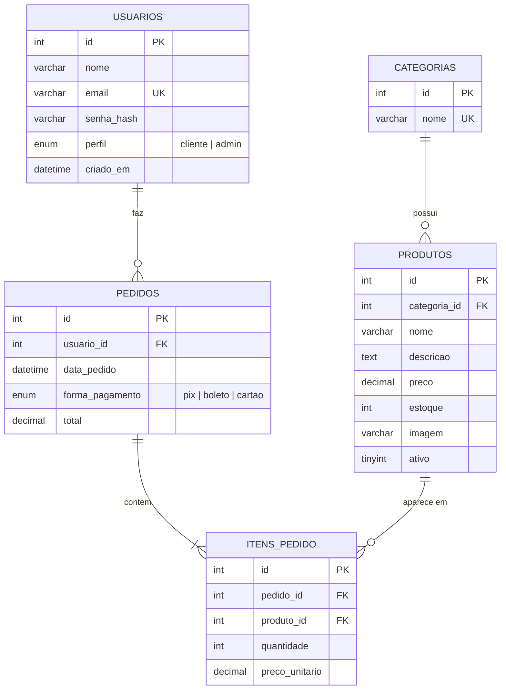

# 🎮 Level Up Store

Projeto final do 4º bimestre (curso de TI): uma loja virtual de games e periféricos com o fluxo completo de venda, desde a vitrine até a baixa de estoque.

> **Aviso:** é um projeto escolar. O pagamento é só uma simulação e os jogos da loja são fictícios.

## O que o sistema faz

**Cliente**
- Vitrine com os produtos vindos do banco de dados
- Busca por nome/descrição e filtro por categoria
- Página do produto (preço, descrição, imagem e estoque)
- Carrinho de compras guardado na sessão (`$_SESSION`): adicionar, alterar quantidade (sem passar do estoque), remover e total
- Cadastro e login
- Checkout só para quem está logado, com pagamento simulado (PIX, Boleto ou Cartão)
- Ao finalizar: cria o pedido, grava os itens, **dá baixa no estoque** e limpa o carrinho
- Histórico de "Meus pedidos"

**Administrador (`/admin`)**
- Painel com resumo (produtos, pedidos, total vendido, estoque baixo)
- CRUD de produtos: cadastrar, listar, editar, desativar/excluir (com upload de imagem)
- Lista de pedidos com os itens e o valor total

## Tecnologias

- HTML5, CSS3, Bootstrap 5 e JavaScript
- PHP 7.4+ (roda no Apache/XAMPP)
- MySQL/MariaDB com PDO

## Como rodar (XAMPP)

1. Instale o [XAMPP](https://www.apachefriends.org/) e inicie o **Apache** e o **MySQL**.
2. Coloque a pasta do projeto em `C:\xampp\htdocs\loja-games` (o nome da pasta tem que bater com o `APP_BASE_URL`).
3. Abra o **phpMyAdmin** (`http://localhost/phpmyadmin`), vá em **Importar** e escolha o arquivo `database/schema.sql`. Ele cria o banco `loja_games`, as tabelas e os dados de teste.
4. Na raiz do projeto, copie o `.env.example` para `.env`:
   ```
   copy .env.example .env
   ```
5. Abra o `.env` e confira os dados do banco. No XAMPP padrão fica assim:
   ```
   DB_HOST=localhost
   DB_PORT=3306
   DB_NAME=loja_games
   DB_USER=root
   DB_PASS=
   APP_BASE_URL=/loja-games
   ```
6. Acesse: **http://localhost/loja-games/**

> O Bootstrap é carregado por CDN, então precisa de internet para o visual aparecer direito.

### Usuários de teste

| Perfil  | E-mail               | Senha        |
|---------|----------------------|--------------|
| Admin   | admin@levelup.com    | `admin123`   |
| Cliente | cliente@levelup.com  | `cliente123` |

(Servem só para testar. As senhas ficam no banco como hash, não em texto puro.)

## Estrutura de pastas

```
loja-games/
├── admin/                 # painel administrativo (só admin)
│   ├── index.php          # resumo
│   ├── produtos.php       # lista de produtos
│   ├── produto_form.php   # cadastrar / editar
│   ├── produto_acao.php   # excluir / desativar / reativar
│   ├── pedidos.php        # pedidos com itens e total
│   └── _menu.php
├── assets/                # css, js e imagens
├── config/
│   ├── env.php            # lê o .env
│   └── database.php       # conexão PDO
├── database/
│   └── schema.sql         # tabelas + dados de teste
├── includes/
│   ├── init.php           # carrega env, banco e sessão
│   ├── funcoes.php        # funções de segurança, login, carrinho...
│   ├── header.php
│   └── footer.php
├── index.php              # vitrine
├── produto.php            # detalhes do produto
├── carrinho.php           # carrinho ($_SESSION)
├── login.php / cadastro.php / logout.php
├── checkout.php           # finalizar compra
├── pedido_sucesso.php
├── meus_pedidos.php
├── .env.example           # modelo (vai pro Git)
└── .gitignore             # ignora o .env
```

## Modelagem do banco



Resumo das regras:
- **usuarios**: `email` é único e `senha_hash` guarda o hash; o `perfil` separa cliente de admin.
- **produtos**: cada produto tem uma categoria; `preco` é `DECIMAL(10,2)` e `estoque` é inteiro.
- **pedidos**: guarda cliente, data, forma de pagamento e total.
- **itens_pedido**: resolve a relação N:N entre produtos e pedidos e guarda a quantidade e o `preco_unitario` **da hora da compra** (se o preço mudar depois, o pedido antigo continua igual).

## Segurança (o que foi feito)

| Requisito | Como foi feito |
|-----------|----------------|
| Sem credenciais no código | `config/database.php` lê tudo do `.env` via `env()` |
| `.env` fora do Git | está no `.gitignore`; o repositório tem só o `.env.example` |
| SQL Injection | todas as consultas com dados do usuário usam **prepared statements** (PDO), sem concatenar variáveis |
| Senhas | `password_hash()` no cadastro e `password_verify()` no login |
| Controle de acesso | `exigirLogin()` e `exigirAdmin()` validam a sessão **no servidor** (o admin é conferido no banco) |
| XSS | tudo que vem do usuário/banco é exibido com `htmlspecialchars` (função `e()`) |
| CSRF | formulários POST têm token de segurança |
| Sessão | `session_regenerate_id()` ao logar e cookie `httponly` |
| Preço e estoque | o preço sempre é lido do banco no checkout, nunca da sessão ou do navegador |
| Compra simultânea | checkout dentro de **transação** com `SELECT ... FOR UPDATE` |
| Upload de imagem | confere o tipo real do arquivo, limita o tamanho e troca o nome |
| Arquivos internos | `.htaccess` bloqueia `.env`, `config/`, `includes/` e `database/` |

## Limitações e melhorias futuras

Coisas que não deu tempo de fazer ou que eu melhoraria depois:
- CRUD de categorias no painel admin (hoje elas vêm do `schema.sql`)
- Paginação na vitrine
- Limite de tentativas de login (proteção contra força bruta)
- Recuperação de senha por e-mail
- Pagamento de verdade (hoje é só simulação)
- Mudar o status do pedido (enviado, entregue...)

## Equipe

- _(nome 1)_
- _(nome 2)_

## Versionamento

O projeto foi feito com Git, com commits pequenos a cada etapa (estrutura, banco, catálogo, carrinho, login, checkout e admin).
